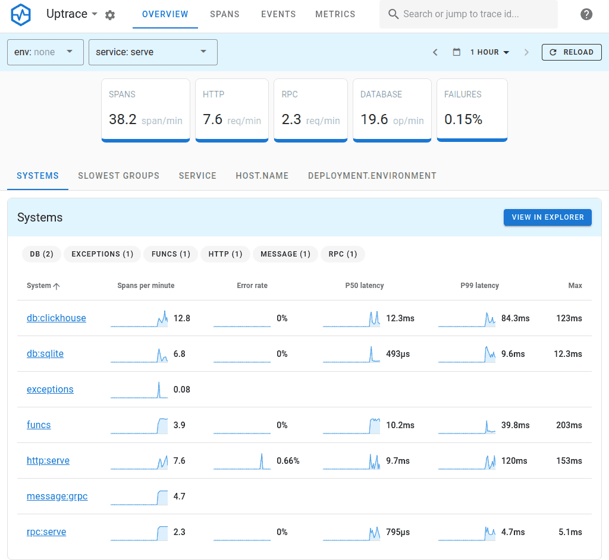
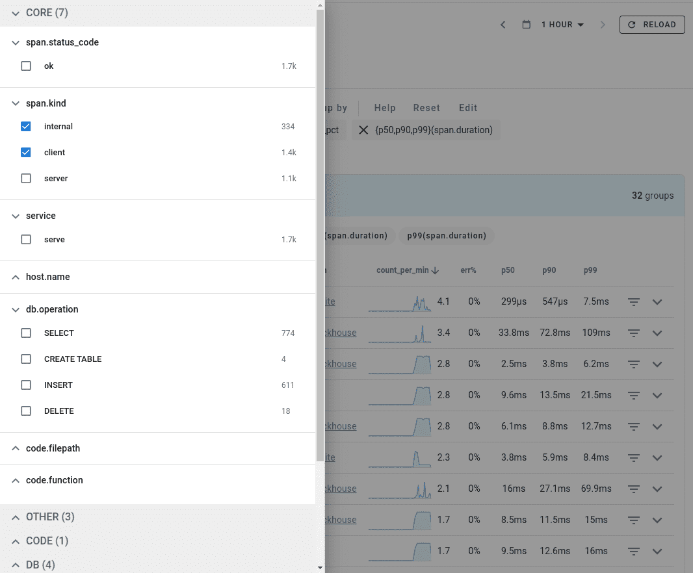
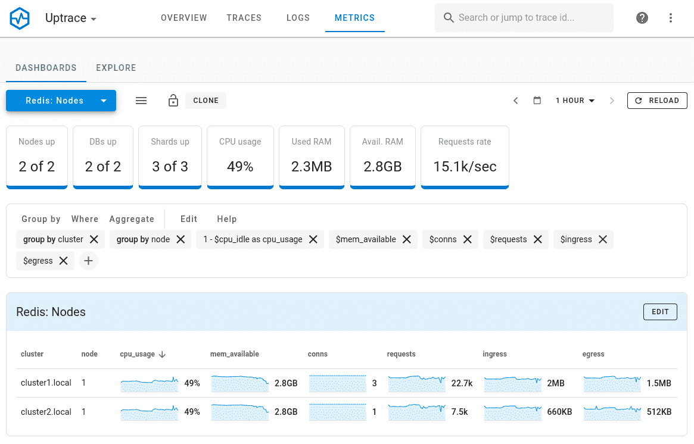
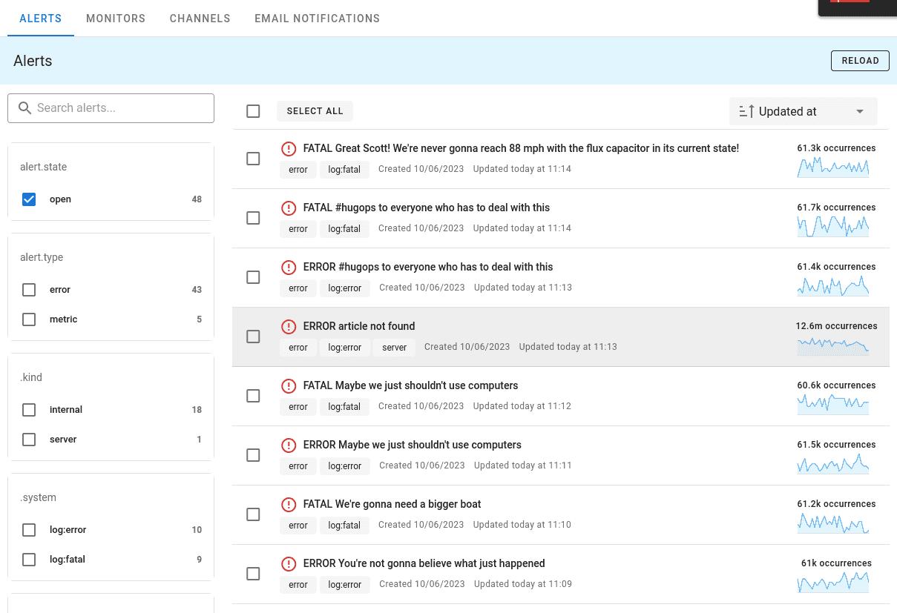

Languages: **English** | [简体中文](README.zh.md)

# Open source APM: OpenTelemetry traces, metrics, and logs

Uptrace is an [open source APM](https://uptrace.dev/get/hosted/open-source-apm)
that supports distributed tracing, metrics, and logs. You can use it to monitor
applications and troubleshoot issues.

Uptrace comes with an intuitive query builder, rich dashboards, alerting rules,
notifications, and integrations for most languages and frameworks.

Uptrace can process billions of spans and metrics on a single server and allows
you to monitor your applications at 10x lower cost.

Uptrace uses OpenTelemetry framework to collect data and ClickHouse database to
store it. It also requires PostgreSQL database to store metadata such as metric
names and alerts.

**Features**:

- Single UI for traces, metrics, and logs.
- 50+ pre-built dashboards that are automatically created once metrics start
  coming in.
- Service graph and
  [chart annotations](https://uptrace.dev/features/annotations).
- Spans/logs/metrics [monitoring](https://uptrace.dev/features/alerting) with
  notifications via Email, Slack, WebHook, and AlertManager.
- SQL-like query language to
  [aggregate spans](https://uptrace.dev/features/querying/spans).
- Promql-like language to
  [aggregate metrics](https://uptrace.dev/features/querying/metrics).
- Data ingestion using
  [OpenTelemetry](https://uptrace.dev/ingest/opentelemetry),
  [Prometheus](https://uptrace.dev/ingest/prometheus),
  [Vector](https://uptrace.dev/ingest/vector),
  [FluentBit](https://uptrace.dev/ingest/logs/fluentbit),
  [CloudWatch](https://uptrace.dev/ingest/cloudwatch), and more.
- [Grafana](https://uptrace.dev/features/grafana) compatibility. You can
  configure Grafana to use Uptrace as a Tempo/Prometheus datasource.
- Dashboard layouts with groups, rows and tabs, a YAML editor, and revision
  history.
- AI-assisted incident analysis that states hypotheses with the data behind
  them, and model providers you configure.
- Optional [Kafka-based ingestion](https://uptrace.dev/get/hosted/scale#kafka)
  for high-volume and multi-node deployments.
- Managing users/projects via YAML config.
- Single sign-on (SSO) using OpenID Connect:
  [Keycloak](https://uptrace.dev/features/sso/keycloak),
  [Google Cloud](https://uptrace.dev/features/sso/google), and
  [Cloudflare](https://uptrace.dev/features/sso/cloudflare).
- Efficient processing: more than 10K spans / second on a single core.
- Excellent on-disk compression: 1KB span can be compressed down to ~40 bytes.

**System overview**

**Faceted filters**

**Metrics**

**Alerts**

## Quickstart

You can try Uptrace in just a few minutes by visiting the
[cloud demo](https://app.uptrace.dev/play) (no login required) or by
[running](https://github.com/uptrace/uptrace/tree/master/example/docker) it
locally with Docker.

Then follow the [getting started](https://uptrace.dev/get) guide.

## Requirements

The latest release is
[v2.1.0](https://github.com/uptrace/uptrace/releases/tag/v2.1.0). It needs:

- ClickHouse 26.3 or later
- PostgreSQL 15 or later
- Redis 6 or later

## Upgrading

Back up PostgreSQL and ClickHouse, then follow
[Upgrading Uptrace](https://uptrace.dev/get/hosted/upgrade). Upgrading from
v2.0.x or a v2.1 beta takes a few extra steps, described in
[Upgrading to v2.1.0](https://uptrace.dev/get/hosted/upgrade#upgrading-to-v210).
See the [changelog](CHANGELOG.md) for the changes in each release.

## Help

Have questions? Get help via [Telegram](https://t.me/uptrace),
[Slack](https://join.slack.com/t/uptracedev/shared_invite/zt-3e35d4b0m-zfAew95ymE5Fv31LwvyuoQ),
or [start a discussion](https://github.com/uptrace/uptrace/discussions) on
GitHub.

## Contributing

