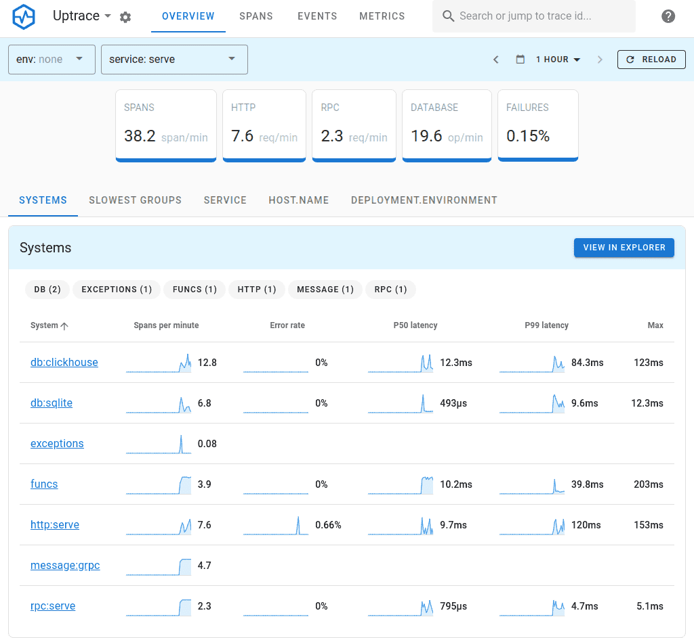
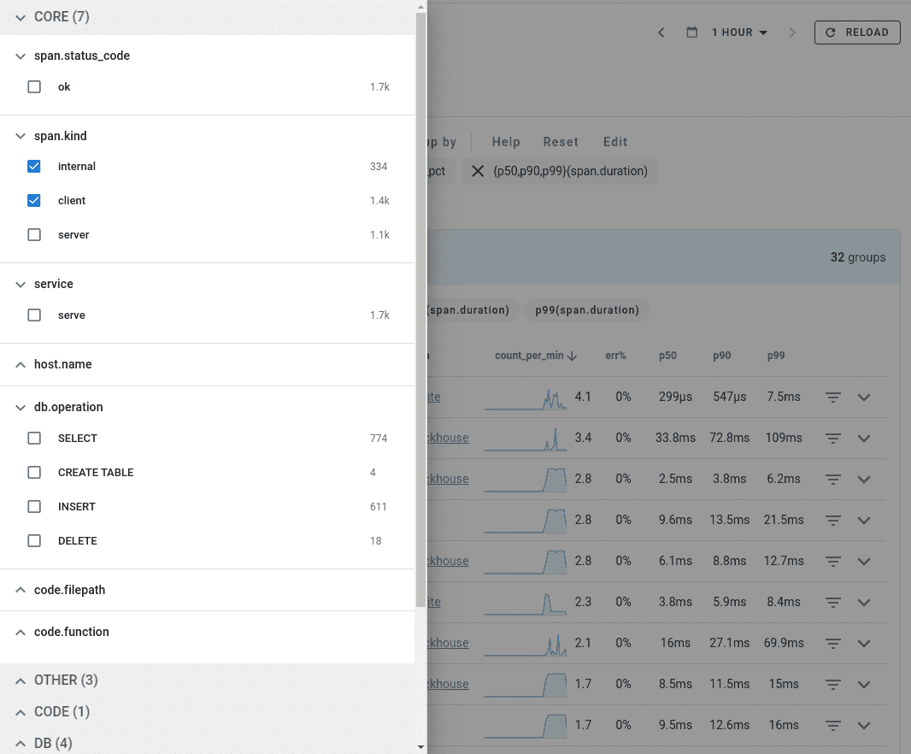
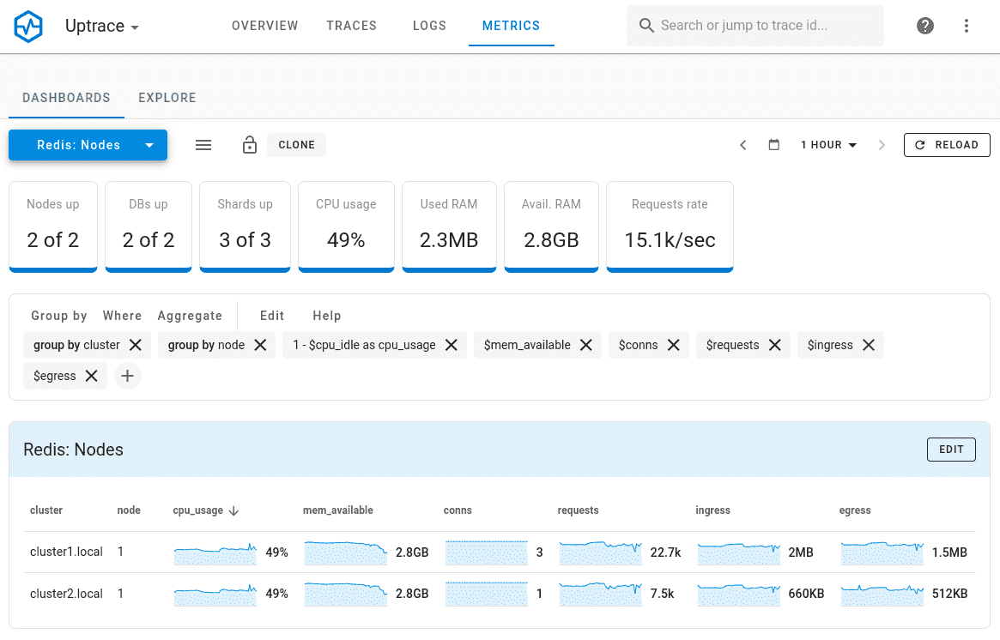
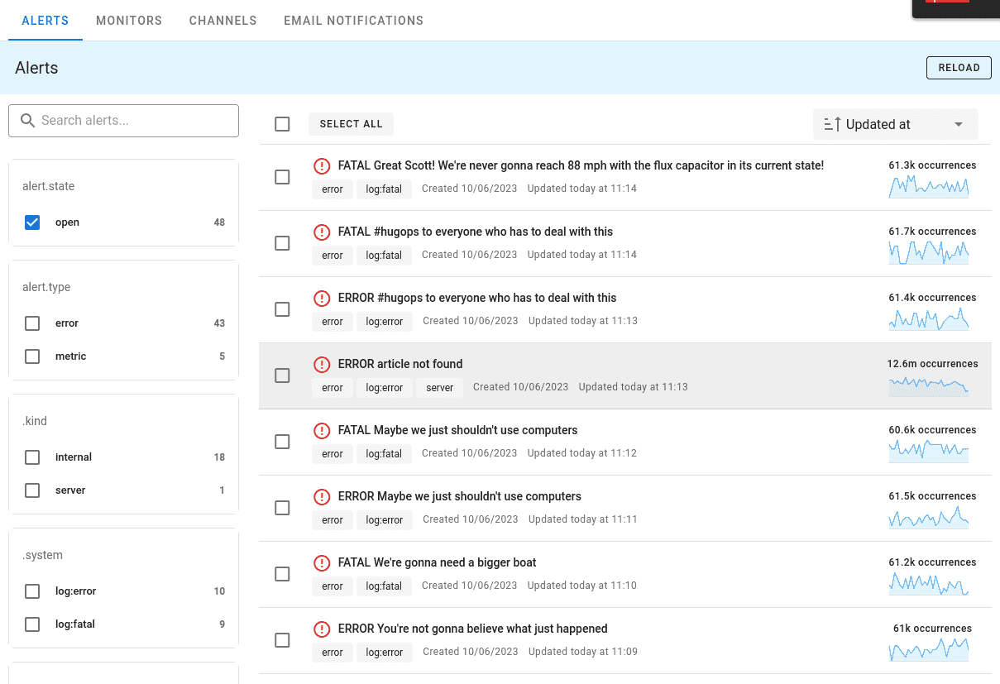

Languages: [English](README.md) | **简体中文**

# 开源 APM：OpenTelemetry 追踪、指标和日志

Uptrace 是一个[开源 APM](https://uptrace.dev/get/hosted/open-source-apm)，支持分布式追踪、指标和日志。您可以使用它来监控应用程序和排查问题。

Uptrace 配备了直观的查询构建器、丰富的仪表板、告警规则、通知，以及对大多数语言和框架的集成支持。

Uptrace 可以在单台服务器上处理数十亿的 span 和指标，让您以 10 倍更低的成本监控您的应用程序。

Uptrace 使用 OpenTelemetry 框架收集数据，使用 ClickHouse 数据库存储数据。它还需要 PostgreSQL 数据库来存储元数据，如指标名称和告警。

**功能特性**：

- 追踪、指标和日志的统一界面。
- 50+ 个预构建仪表板，一旦指标开始传入就会自动创建。
- 服务图和[图表注释](https://uptrace.dev/features/annotations)。
- 通过 Email、Slack、WebHook 和 AlertManager 进行 Spans/日志/指标[监控](https://uptrace.dev/features/alerting)和通知。
- 类似 SQL 的查询语言用于[聚合 spans](https://uptrace.dev/features/querying/spans)。
- 类似 Promql 的语言用于[聚合指标](https://uptrace.dev/features/querying/metrics)。
- 支持通过 [OpenTelemetry](https://uptrace.dev/ingest/opentelemetry)、[Prometheus](https://uptrace.dev/ingest/prometheus)、[Vector](https://uptrace.dev/ingest/vector)、[FluentBit](https://uptrace.dev/ingest/logs/fluentbit)、[CloudWatch](https://uptrace.dev/ingest/cloudwatch) 等进行数据摄取。
- [Grafana](https://uptrace.dev/features/grafana) 兼容性。您可以配置 Grafana 使用 Uptrace 作为 Tempo/Prometheus 数据源。
- 仪表板布局：支持分组、行和标签页，提供 YAML 编辑器和修订历史。
- AI 辅助的事件分析：给出假设及其依据的数据，并可配置模型提供商。
- 可选的[基于 Kafka 的数据摄取](https://uptrace.dev/get/hosted/scale#kafka)，适用于高吞吐量和多节点部署。
- 通过 YAML 配置管理用户/项目。
- 使用 OpenID Connect 的单点登录 (SSO)：[Keycloak](https://uptrace.dev/features/sso/keycloak)、[Google Cloud](https://uptrace.dev/features/sso/google) 和 [Cloudflare](https://uptrace.dev/features/sso/cloudflare)。
- 高效处理：单核每秒处理超过 10K spans。
- 出色的磁盘压缩：1KB span 可以压缩到约 40 字节。

**系统概览**

**分面过滤器**

**指标**

**告警**

## 快速开始

您可以通过访问[云端演示](https://app.uptrace.dev/play)（无需登录）或使用 Docker [本地运行](https://github.com/uptrace/uptrace/tree/master/example/docker)在几分钟内试用 Uptrace。

然后按照[入门指南](https://uptrace.dev/get)操作。

## 系统要求

最新版本为 [v2.1.0](https://github.com/uptrace/uptrace/releases/tag/v2.1.0)。它需要：

- ClickHouse 26.3 或更高版本
- PostgreSQL 15 或更高版本
- Redis 6 或更高版本

## 升级

先备份 PostgreSQL 和 ClickHouse，然后按照[升级 Uptrace](https://uptrace.dev/get/hosted/upgrade) 操作。从 v2.0.x 或 v2.1 beta 升级需要几个额外步骤，详见[升级到 v2.1.0](https://uptrace.dev/get/hosted/upgrade#upgrading-to-v210)。每个版本的变更见[更新日志](CHANGELOG.md)。

## 帮助

有疑问？通过 [Telegram](https://t.me/uptrace)、[Slack](https://join.slack.com/t/uptracedev/shared_invite/zt-3e35d4b0m-zfAew95ymE5Fv31LwvyuoQ) 获取帮助，或在 GitHub 上[发起讨论](https://github.com/uptrace/uptrace/discussions)。

## 贡献

